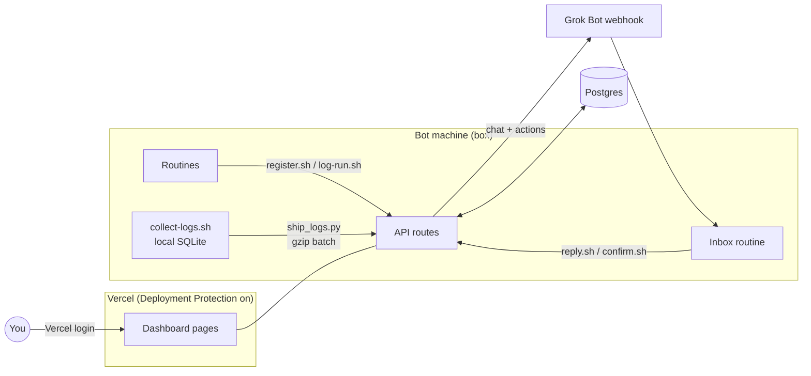

# GrugBot Console

grug have many bot. bots run routines. grug forget which bot do what, when, and did it work.

so grug make console. one page show all routines. grug see every run. grug pause routine, change schedule, change prompt. grug chat with Grok Bot about routine. grug also see logs from box where bots live.

**see demo first:** https://grugbot-console-demo.vercel.app

demo use fake bots and fake data. click all buttons. nothing break. nothing saved.


app is Next.js on Vercel plus any Postgres. few small shell and Python scripts live on box and talk to app over HTTPS. that it. no kubernetes. no message queue. grug happy.

## Install grugbot

`grugbot` is small CLI. it set up console for you.

```bash
brew install OWNER/tap/grugbot        # macOS and Linux
winget install OWNER.grugbot          # Windows
```

## Quickstart

```bash
grugbot init
```


`grugbot init` ask grug few things, then do boring work:

1. ask for Vercel token. token hidden when typed. token not saved. make one at https://vercel.com/account/tokens (Vercel have no device login for tools like this, so token it is).
2. ask which Vercel team.
3. ask where data live: your own Postgres, or free Neon database from Vercel Marketplace. own Postgres get tested right away: connect, then make and drop small table.
4. make Vercel project. set `DATABASE_URL` and new random `ROUTINE_LOG_TOKEN`.
5. turn on Vercel Authentication, so only your team see console. make bypass secret so box scripts still get in.
6. deploy. wait for ready. poke live URL to check login wall up and API alive.
7. write box secrets to `~/.config/grugbot/box.env` with mode 600. secrets never printed. grug not want secrets in terminal scrollback.

with Neon option, grugbot open Marketplace page in browser and wait until Neon put `DATABASE_URL` on project.

other commands:

| Command | What it do |
|---|---|
| `grugbot init` | first setup, like above |
| `grugbot doctor` | check config, file modes, database, project, env vars, protection, last deploy, live request |
| `grugbot deploy` | deploy app again, for example after `brew upgrade grugbot` |
| `grugbot uninstall` | delete Vercel project and local grugbot files. grug must type project name first. database not touched. |

every command take `--dry-run`. it print API calls and change nothing. for scripts, `--yes` skip questions and read `--team`, `--project`, `--db own|neon` and `--database-url` (or `DATABASE_URL`) from flags.

## Box setup

box is machine where bots run. four steps. do once.

**1. install box scripts**

```bash
git clone https://github.com/OWNER/grokbot-routines.git
mkdir -p /workspace/grugbot-console
# copy ~/.config/grugbot/box.env (from grugbot init) to /workspace/grugbot-console/.env
chmod 600 /workspace/grugbot-console/.env
INSTALL_DIR=/workspace/grugbot-console grokbot-routines/box/install.sh
```

what this do: copy scripts into `INSTALL_DIR`, start log loop. safe to run again (it is also how you update). setting missing? it print one line like `missing: VERCEL_BYPASS` and exit 3. never print secrets.

**2. make dashboard inbox routine**

follow [`routine/README.md`](routine/README.md): new Grok Bot routine, webhook trigger, paste [`routine/dashboard-inbox.prompt.md`](routine/dashboard-inbox.prompt.md).

what this do: routine catch console buttons and chat, do the routine work, report back.

**3. tell console the webhook**

put routine's webhook URL and key in database (no redeploy needed):

```sql
insert into config(key, value, updated_at)
values ('grokbot_webhook', '{"url": "https://...", "key": "..."}'::jsonb, now())
on conflict (key) do update set value = excluded.value, updated_at = now();
```

or set Vercel env vars `GROKBOT_WEBHOOK_URL` + `GROKBOT_WEBHOOK_KEY` and run `grugbot deploy`. database wins if both set.

**4. check it work**

- top bar of console show box with green dot (pinged under 2 minutes ago).
- send message on `/chat`. note under it say "Delivered to Grok Bot".
- `grugbot doctor` say all good.

lazy way: tell your Grok Bot "set up GrugBot Console". it ask for secrets with secure secret request (never in chat) and do step 1.

<details>
<summary>box script reference</summary>

| Script | What it do |
|---|---|
| `install.sh` | install or update. keeps `.env`, `.token`, `logs/`, `runs.jsonl`, `registry.jsonl`, your edited `ship-config.json` |
| `ensure-running.sh` | start log loop if dead. few milliseconds if alive. routines run it on wake, so loop survive reboot |
| `register.sh bot bot_id routine_id name schedule_or_trigger purpose [active\|paused]` | add or update routine on console |
| `log-run.sh bot routine_id ok\|error\|skipped summary` | record one run |
| `reply.sh thread_id text` | Grok Bot reply into chat thread |
| `confirm.sh routine_id ok\|fail ['{json}'] ['note']` | finish (or reject) pending change |
| `prompt.sh routine_id prompt_file` | send routine prompt to console (answer to fetch) |
| `logs.sh [-s source] [-l level] [-t 2h] [-g text] [-n 50]` / `logs.sh sources` | read local log copy |

`.env` keys: `ROUTINE_LOG_URL`, `ROUTINE_LOG_TOKEN`, `VERCEL_BYPASS`. how each bot register its routines: [`box/SETUP.md`](box/SETUP.md).

</details>

## Database

any recent Postgres work (grug test Postgres 17 and PGlite). Neon, Supabase, RDS, box in closet. tables made on first request.

user need only this:

```sql
create user grugbot password '...';
grant connect on database grugbot to grugbot;
grant usage, create on schema public to grugbot;
```

| TLS setting | Effect |
|---|---|
| `sslmode=require` / `verify-full` / `disable` in URL | used as given |
| no `sslmode`, not localhost | TLS on, certificate checked |
| `DATABASE_SSL=no-verify` | TLS on, self-signed OK |
| `DATABASE_SSL=off` | TLS off |

## Demo mode

`DEMO_MODE=1`, no `DATABASE_URL`. app run on in-memory Postgres (PGlite) filled from `lib/demo-fixtures.js`. browser writes faked by `public/demo-shim.js` (gone when tab close). server answer every POST with fake "ok" (`middleware.js`). nothing saved, ever.

## How it work



life of a Pause click:

1. grug click Pause. console save pending change.
2. console send it to Grok Bot webhook.
3. inbox routine make change (or ask owner bot to).
4. routine run `confirm.sh`. pending clear, status update.
5. page notice. (page check every 5 s while something pending, every minute otherwise, never while tab hidden.)

| Page | What |
|---|---|
| `/bots` | bots and what they been doing |
| `/` | routines by bot, buttons, run history |
| `/chat` | Grok Bot threads |
| `/logs` | box logs, filter by source, level, instance, time, text, regex |
| `/settings` | "Always reply in Grok Bot chat" (sent as `also_chat`), log ship interval |

<details>
<summary>API reference</summary>

| Route | Auth | Purpose |
|---|---|---|
| `POST /api/register` | bearer | add or update a routine |
| `POST /api/runs` | bearer | record a run (`ok`, `error`, `skipped`) |
| `POST /api/messages` | bearer | Grok Bot reply into a thread |
| `POST /api/routines/confirm` | bearer | apply or reject a pending change |
| `POST /api/routines/prompt` | bearer | owner bot sends a routine prompt (answer to `fetch_prompt`) |
| `POST /api/bots` | bearer | bot profiles and content-free activity |
| `POST /api/logs` | bearer | batch log ingest, JSON array, gzip allowed |
| `/api/chat`, `/api/actions`, `/api/settings` | Vercel login | used by the dashboard |

bearer = `Authorization: Bearer $ROUTINE_LOG_TOKEN` plus `x-vercel-protection-bypass` header.

</details>

<details>
<summary>env vars</summary>

| Where | Name | What |
|---|---|---|
| Vercel | `DATABASE_URL` | Postgres connection |
| Vercel | `ROUTINE_LOG_TOKEN` | bearer token for box scripts |
| Vercel | `DATABASE_SSL` | optional: `no-verify` or `off` |
| Vercel | `DEMO_MODE` | `1` for demo, no database |
| Vercel | `GROKBOT_WEBHOOK_URL`, `GROKBOT_WEBHOOK_KEY` | fallback if `grokbot_webhook` not in `config` table |
| box `.env` | `ROUTINE_LOG_URL`, `ROUTINE_LOG_TOKEN`, `VERCEL_BYPASS` | how box reach console |

</details>

<details>
<summary>manual setup (no grugbot)</summary>

1. make Vercel project from this repo. set `DATABASE_URL` (or add Neon from Vercel Marketplace).
2. turn on Vercel Authentication. make Protection Bypass for Automation secret.
3. set `ROUTINE_LOG_TOKEN` to long random string.
4. do Box setup above.

</details>

## What box send

grug not snoop. box send only this:

| Thing | What leave box | Kept on server |
|---|---|---|
| logs | new lines from allowed sources, redacted twice, gzipped | 7 days, max 200,000 rows |
| bot activity | time, bot, event or tool name, target bot name. no commands, args, messages, results | 7 days, max 50,000 events |
| bot profiles | name, title, description, colour from `profile.json`. bot ids hashed | latest |
| heartbeat | hashed `machine_id` (stable) and `instance_id` (per boot), hostname, boot time, version | 30 days |
| prompts | only when you ask (Edit prompt) | in database, never in repo |

<details>
<summary>log details</summary>

- `collect-logs.sh` read new lines from `/var/log`, `/tmp`, tool caches, files running processes write, kernel log, journal, per-minute network summary, into `logs/box-logs.db` (SQLite). local copy kept 30 days, max 50 MB.
- never read: shell histories, `.env` and token files, agent transcript content.
- redaction catch things that look like token, password, key, JWT, URL with credentials. patterns miss some. check `ship-config.json` before allowing new source.
- `ship-config.json` hold allow/deny lists and `catalog` (feed Logs page (i) tooltip).
- loop run at lowest CPU and IO priority on ship interval from Settings (15 s to 10 min, default 1 min, box re-read setting at most every 5 min). nothing new = no request, just heartbeat at most every 5 min.
- top bar dot: green under 2 min since ping, amber under 10, grey after.

</details>

## Security

- every page and route behind Vercel Authentication. bot routes also need bearer token.
- secrets only in Vercel env vars, database `config` table, box `.env`. never in repo.
- scripts never print tokens. webhook errors hide key.
- `confirm.sh` and `reply.sh` fail loud on any non-2xx or redirect, so broken bypass secret not fail quiet.

## Cost

free on Vercel plan you have plus free Postgres tier. about 43,000 small requests a month at default 1-minute ship interval. serverless database like Neon stay awake while box ship every minute; longer interval in Settings let it sleep.

## Releasing

1. push `v*` tag.
2. GitHub Actions run GoReleaser: build `grugbot` for macOS, Linux, Windows (amd64 + arm64), bundle web app inside, write `checksums.txt`.
3. it make **draft** release. human press publish.

<details>
<summary>packaging and tests</summary>

- Homebrew: set `HOMEBREW_TAP_TOKEN` secret and GoReleaser push cask to `OWNER/homebrew-tap`. by-hand formula: `packaging/homebrew/grugbot.rb.tmpl`.
- winget: fill `packaging/winget/OWNER.grugbot.yaml` from `checksums.txt`, submit to `microsoft/winget-pkgs`.
- local build check: `goreleaser release --snapshot --clean`
- CLI tests: `cd cli && GRUGBOT_TEST_DB=postgres://... go test ./...` (runs `init` end to end against fake Vercel API and real Postgres)
- `docs/init.gif` made with [VHS](https://github.com/charmbracelet/vhs) from `docs/init.tape`, against fake Vercel API (`cli/cmd/fakevercel`). no real token, no real database.

</details>

## Philosophy

code follow [grug brain](https://grugbrain.dev) way: complexity very, very bad. plain React, plain CSS, no UI kit. one exception: Logs table use TanStack Table + Virtual, because thousands of rows worth not hand-rolling. nothing clever that tired grug can't read at 2 AM.

thank you grugbrain.dev. go read it. it short. it good.

## License

MIT
