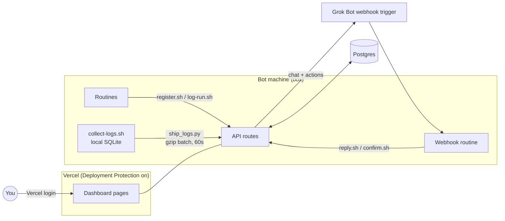

# GrugBot Console

grug have many bot. bots run routines. grug forget which bot do what, when, and did it work.

so grug make console. one page show all routines. grug see every run. grug pause routine, change schedule, change prompt. grug chat with Grok Bot about routine. grug also see logs from box where bots live.

**see demo first:** https://grugbot-console-demo.vercel.app

demo use fake bots and fake data. click all buttons. nothing break. nothing saved.


app is Next.js on Vercel plus any Postgres. few small shell and Python scripts live on box and talk to app over HTTPS. that it. no kubernetes. no message queue. grug happy.

## Install grugbot

`grugbot` is small CLI. it set up console for you.

```bash
brew install OWNER/tap/grugbot        # macOS and Linux
winget install OWNER.grugbot          # Windows
```

## Quickstart

```bash
grugbot init
```


`grugbot init` ask grug few things, then do boring work:

1. ask for Vercel token. token hidden when typed. token not saved. make one at https://vercel.com/account/tokens (Vercel have no device login for tools like this, so token it is).
2. ask which Vercel team.
3. ask where data live: your own Postgres, or free Neon database from Vercel Marketplace. own Postgres get tested right away: connect, then make and drop small table.
4. make Vercel project. set `DATABASE_URL` and new random `ROUTINE_LOG_TOKEN`.
5. turn on Vercel Authentication, so only your team see console. make bypass secret so box scripts still get in.
6. deploy. wait for ready. poke live URL to check login wall up and API alive.
7. write box secrets to `~/.config/grugbot/box.env` with mode 600. secrets never printed. grug not want secrets in terminal scrollback.

with Neon option, grugbot open Marketplace page in browser and wait until Neon put `DATABASE_URL` on project.

other commands:

| Command | What it do |
|---|---|
| `grugbot init` | first setup, like above |
| `grugbot doctor` | check config, file modes, database, project, env vars, protection, last deploy, live request |
| `grugbot deploy` | deploy app again, for example after `brew upgrade grugbot` |
| `grugbot uninstall` | delete Vercel project and local grugbot files. grug must type project name first. database not touched. |

every command take `--dry-run`. it print API calls and change nothing. for scripts, `--yes` skip questions and read `--team`, `--project`, `--db own|neon` and `--database-url` (or `DATABASE_URL`) from flags.

## Box setup

box is machine where bots run. after `grugbot init`, on box:

```bash
git clone https://github.com/OWNER/grokbot-routines.git
# copy ~/.config/grugbot/box.env from your computer to $INSTALL_DIR/.env on the box, then chmod 600 it
INSTALL_DIR=/workspace/grugbot-console grokbot-routines/box/install.sh
```

or tell your Grok Bot "set up GrugBot Console". it ask for secrets with secure secret request (never in chat), clone repo, run installer.

`install.sh` safe to run again and again. it copy scripts into `INSTALL_DIR` (default `/workspace/grugbot-console`) and only replace files that changed. it never touch `.env`, `.token`, `logs/`, `runs.jsonl`, `registry.jsonl`, or `ship-config.json` you edited. if setting missing, it say one line like `missing: VERCEL_BYPASS` and exit 3. it never print your secrets. it start log loop only if loop not already running.

`ensure-running.sh` is tiny. if loop alive, return in few milliseconds. if loop dead, start it. routines run it when they wake, so loop come back after reboot.

`box/SETUP.md` tell each bot how to register its routines.

last piece: Grok Bot routine that catch console webhooks and do the work. prompt and setup steps in [`routine/`](routine/README.md).

## Database

any recent Postgres work. grug test Postgres 17 and PGlite. Neon, Supabase, RDS, Cloud SQL, box in closet, all fine. app use plain `node-postgres`. nothing vendor special.

database user need `CONNECT` on database and `USAGE` plus `CREATE` on one schema (normally `public`). tables made on first request. small locked-down user look like this:

```sql
create user grugbot password '...';
grant connect on database grugbot to grugbot;
grant usage, create on schema public to grugbot;
```

TLS: put `sslmode` in URL (`require`, `verify-full` or `disable`). no `sslmode` and not localhost? then TLS on, certificate checked. `DATABASE_SSL=no-verify` for self-signed certificate. `DATABASE_SSL=off` turn TLS off.

## Demo mode

set `DEMO_MODE=1` and leave `DATABASE_URL` empty. app then run on in-memory Postgres (PGlite) filled from `lib/demo-fixtures.js`: four fake bots, their routines, week of runs, logs, chat threads, heartbeats.

browser writes faked in page by `public/demo-shim.js` and kept in sessionStorage. close tab, all gone. on server, `middleware.js` answer every POST with fake "ok", so nothing stored. public demo is this mode on own Vercel project with Vercel Authentication off.

## How it fit together



pause work like this. grug click Pause. app store pending change and send it to Grok Bot webhook. bot that own routine make change, then call `confirm.sh`. that clear pending flag and set new status. page check every 5 seconds while something pending, once a minute otherwise, and stop checking when tab hidden.

## Pages

- `/bots` list bots and what they been doing. `/` show routines grouped by bot, with buttons and run history. `/chat` hold Grok Bot threads.
- `/logs` show box logs. filter by source, level, instance, time, text or regex.
- `/settings` hold "Always reply in Grok Bot chat" and ship interval. value live in `config` table so webhook routine can read it, and go out as `also_chat` on every chat and action payload.

## API

| Route | Auth | Purpose |
|---|---|---|
| `POST /api/register` | bearer | add or update a routine |
| `POST /api/runs` | bearer | record a run (`ok`, `error`, `skipped`) |
| `POST /api/messages` | bearer | Grok Bot reply into a thread |
| `POST /api/routines/confirm` | bearer | apply or reject a pending change |
| `POST /api/routines/prompt` | bearer | owner bot sends a routine prompt (answer to `fetch_prompt`) |
| `POST /api/bots` | bearer | bot profiles and content-free activity |
| `POST /api/logs` | bearer | batch log ingest, JSON array, gzip allowed |
| `/api/chat`, `/api/actions`, `/api/settings` | Vercel login | used by the dashboard |

bearer routes want `Authorization: Bearer $ROUTINE_LOG_TOKEN` plus `x-vercel-protection-bypass` header, because Deployment Protection stand in front of everything.

## Manual setup (no grugbot)

`grugbot init` do steps 1 to 3. by hand:

1. make Vercel project from this repo. set `DATABASE_URL` to any Postgres (or add Neon from Vercel Marketplace, which set it for you). tables made on first request.
2. turn on Deployment Protection (Vercel Authentication). make Protection Bypass for Automation secret for box scripts.
3. set `ROUTINE_LOG_TOKEN` in project to long random string.
4. make Grok Bot routine with webhook trigger (prompt and steps in [`routine/`](routine/README.md)). store its URL and key in `config` table under key `grokbot_webhook` as `{"url": "...", "key": "..."}`. env vars `GROKBOT_WEBHOOK_URL` and `GROKBOT_WEBHOOK_KEY` work as fallback.
5. on box, run `box/install.sh` like in Box setup above.

## Box logs

`collect-logs.sh` read new lines from `/var/log`, `/tmp`, tool caches, files running processes write to, kernel log, journal, and per-minute network summary. it put them in `logs/box-logs.db` (SQLite) next to scripts. it remember read offset per file. it redact anything that look like token, password, key, JWT or URL with credentials. it delete lines older than 30 days and cap file at 50 MB. shell histories, `.env` and token files, and agent transcripts never read. grug not snoop.

`ship_logs.py` send only new lines from allowed sources, redacted second time, in one gzipped POST. nothing new? no request. edit `ship-config.json` to change allow and deny lists. by default everything readable shipped. `catalog` block in that file feed the (i) tooltip on Logs page.

`start-log-loop.sh` run both on ship interval from Settings (15 seconds to 10 minutes, default 1 minute; box re-read it at most every 5 minutes) at lowest CPU and IO priority. plain sleep loop. no cron. nothing keep machine awake. run `logs.sh sources` or `logs.sh -s exec-daemon -l error -t 2h -g timeout` to read local copy.

server keep 7 days and at most 200,000 log rows, pruned on each ingest.

## Routine prompts

"Edit prompt" on routine ask owning bot for its current prompt (`fetch_prompt`). bot answer with `box/prompt.sh <routine_id> <file>`. grug edit it next to line diff and save. that make pending `set_prompt` change. bot apply it and confirm with `confirm.sh <id> ok '{"prompt":"..."}'`. prompts live only in database behind Vercel Authentication, never in this repo.

## Bots tab

`bot_sync.py` run in same loop. it read each bot's `profile.json` (name, title, description, colour) and send them when they change. bot ids hashed before they leave box.

it also build activity feed per bot from agent audit log and transcripts. each event keep four things only: time, bot, event or tool name (like `shell` or `web_search`), and target bot name when one bot hand work to another. commands, arguments, messages and results never read into feed. transcripts have no timestamps, so event get time loop first saw it; first sync use file modified time. server keep 7 days and 50,000 events.

## Instances

every batch from box carry two hashed ids. `machine_id` is hash of `/etc/machine-id`, same across reboots. `instance_id` hash machine-id plus kernel boot id, so each boot get new one. raw ids never leave box. server keep one heartbeat row per instance: hostname, boot time, version, first seen, last ping. every log row stamped with its instance.

nothing new to ship? box send small heartbeat at most every 5 minutes. top bar show latest box and how long since ping: green under 2 minutes, amber under 10, grey after. hover to see recent instances. Logs table have Instance column and filter.

## Security notes

- every page and route behind Vercel Authentication. bot routes also need bearer token.
- secrets live in Vercel env vars, database `config` table and box `.env`. never in repo. `.gitignore` keep out `.env*`, `*.token`, `*.jsonl` and key files.
- scripts never print tokens. webhook errors hide the key.
- `confirm.sh` and `reply.sh` exit nonzero on any non-2xx or redirect, so broken bypass secret show up as failure, not silence.
- redaction use patterns and will miss some secrets. look at `ship-config.json` before allowing new source.

## Cost

on Vercel plan you already have, plus free Postgres tier, this cost nothing. log shipping add at most one small function call per ship interval while box on, about 43,000 a month at default of one minute. on serverless database like Neon, one write a minute keep compute awake while box run, so watch compute hours on free plan. longer ship interval in Settings let it sleep between batches.

## Releasing

releases built by GoReleaser from `.goreleaser.yaml` when `v*` tag pushed (`.github/workflows/release.yml`). it build `grugbot` for macOS, Linux and Windows on amd64 and arm64, bundle web app into binary (`cli/scripts/bundle.sh`), write `checksums.txt` (SHA-256), and make **draft** GitHub release. human press publish. grug like human press publish.

- Homebrew: with `HOMEBREW_TAP_TOKEN` secret, GoReleaser push cask to `OWNER/homebrew-tap`. `packaging/homebrew/grugbot.rb.tmpl` is same thing as formula, for doing by hand.
- winget: fill `packaging/winget/OWNER.grugbot.yaml` from `checksums.txt` and submit to `microsoft/winget-pkgs`.

local check: `goreleaser release --snapshot --clean`. CLI tests: `cd cli && GRUGBOT_TEST_DB=postgres://... go test ./...` run `init` end to end against fake Vercel API and real Postgres.

GIF above made with [VHS](https://github.com/charmbracelet/vhs) from `docs/init.tape`, against same fake Vercel API (`cli/cmd/fakevercel`) and throwaway local Postgres. no real token, no real database.

## Philosophy

code follow [grug brain](https://grugbrain.dev) way: complexity very, very bad. plain React and plain CSS, no UI kit. one exception: Logs table use TanStack Table and TanStack Virtual (headless, no styling), because sorting and drawing thousands of rows is part worth not hand-rolling. one file per page when possible. nothing clever that tired grug can't read at 2 AM.

thank you grugbrain.dev for words of wisdom. go read it. it short. it good.

## License

MIT
