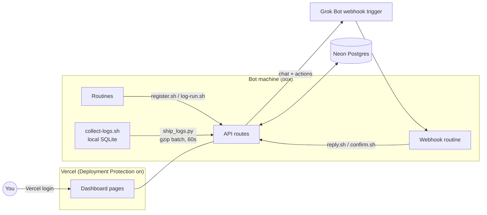

# grokbot-routines

The app calls itself the GrugBot Management Console. It has four tabs: Bots, Routines, Logs and Chat, plus Settings.

A small dashboard for Grok Bot routines. It lists every routine your bots run, records each run, lets you pause, resume or reschedule a routine, and gives you a chat thread with Grok Bot per routine. It can also show recent logs from the machine your bots run on.

It is a Next.js app on Vercel with a Neon Postgres database. A few shell and Python scripts run on the bot's machine (the "box") and talk to the app over HTTPS.

## How it fits together



A pause works like this. You click Pause, the app stores a pending change and posts it to the Grok Bot webhook. The bot that owns the routine makes the change and calls `confirm.sh`, which clears the pending flag and sets the new status. The page polls every 5 seconds while something is pending and once a minute otherwise, and it stops polling when the tab is hidden.

## Pages

- `/bots` lists bots with their activity, `/` shows routines grouped by bot with controls and run history, and `/chat` holds the Grok Bot threads.
- `/logs` shows box logs with filters for source, level, time range and text, 100 lines per page.
- `/settings` holds "Always reply in Grok Bot chat". The value lives in the `config` table so the webhook routine can read it, and it is sent as `also_chat` on every chat and action payload.

## API

| Route | Auth | Purpose |
|---|---|---|
| `POST /api/register` | bearer | add or update a routine |
| `POST /api/runs` | bearer | record a run (`ok`, `error`, `skipped`) |
| `POST /api/messages` | bearer | Grok Bot reply into a thread |
| `POST /api/routines/confirm` | bearer | apply or reject a pending change |
| `POST /api/routines/prompt` | bearer | owner bot sends a routine prompt (answer to `fetch_prompt`) |
| `POST /api/bots` | bearer | bot profiles and content-free activity |
| `POST /api/logs` | bearer | batch log ingest, JSON array, gzip allowed |
| `/api/chat`, `/api/actions`, `/api/settings` | Vercel login | used by the dashboard |

Bearer routes expect `Authorization: Bearer $ROUTINE_LOG_TOKEN` plus the `x-vercel-protection-bypass` header, because Deployment Protection sits in front of everything.

## Install with Grok Bot

Tell your Grok Bot "set up GrugBot Console". It deploys the app, asks you for the three secrets through a secure secret request (never in chat), clones this repo onto its box and runs the installer. After that, any routine that touches the dashboard runs `box/ensure-running.sh` when it wakes, so the loop comes back after a reboot.

To do it by hand, deploy the app first (see Setup below), then on the box:

```bash
git clone https://github.com/OWNER/grokbot-routines.git
export ROUTINE_LOG_URL=https://your-app.vercel.app ROUTINE_LOG_TOKEN=... VERCEL_BYPASS=...
INSTALL_DIR=/workspace/grugbot-console grokbot-routines/box/install.sh
```

`install.sh` is safe to run again. It copies the scripts into `INSTALL_DIR` (default `/workspace/grugbot-console`) and only replaces files that changed. It never touches `.env`, `.token`, `logs/`, `runs.jsonl`, `registry.jsonl` or a `ship-config.json` you edited. Missing settings come back as one line, for example `missing: VERCEL_BYPASS`, with exit code 3, and nothing is printed from your secrets. The loop starts only if it isn't already running.

`ensure-running.sh` returns in a few milliseconds when the loop is alive and starts it when it isn't.

## Setup

1. Create a Vercel project from this repo and add Neon from the Vercel Marketplace. That sets `DATABASE_URL`. Tables are created on first request.
2. Turn on Deployment Protection (Vercel Authentication) and create a Protection Bypass for Automation secret for the box scripts.
3. Set `ROUTINE_LOG_TOKEN` in the project to a long random string.
4. Create a Grok Bot routine with a webhook trigger. Store its URL and key in the `config` table under key `grokbot_webhook` as `{"url": "...", "key": "..."}`. Env vars `GROKBOT_WEBHOOK_URL` and `GROKBOT_WEBHOOK_KEY` work as a fallback.
5. On the box, run `box/install.sh` as described above. See `box/SETUP.md` for the steps each bot follows to register its routines.

## Box logs

`collect-logs.sh` reads new lines from `/var/log`, `/tmp`, tool caches, the files running processes write to, the kernel log, the journal and a per-minute network summary into `logs/box-logs.db` (SQLite) next to the scripts. It keeps a read offset per file, redacts anything that looks like a token, password, key, JWT or credentialed URL, deletes lines older than 30 days and caps the file at 50 MB. Shell histories, `.env` and token files, and agent transcripts are never read.

`ship_logs.py` sends only new lines from allowlisted sources, redacted a second time, in one gzipped POST. When nothing is new it makes no request. Edit `ship-config.json` to change the allow and deny lists. By default everything readable is shipped. The `catalog` block in that file feeds the (i) tooltip on the Logs page.

`start-log-loop.sh` runs both on the ship interval from Settings (15 seconds to 10 minutes, default 1 minute; the box re-reads it at most every 5 minutes) at the lowest CPU and IO priority. It is a plain sleep loop with no cron dependency and nothing that would keep the machine awake. Run `logs.sh sources` or `logs.sh -s exec-daemon -l error -t 2h -g timeout` to read the local copy.

The server keeps 7 days and at most 200,000 log rows, pruned on each ingest.

## Routine prompts

"Edit prompt" on a routine asks the owning bot for its current prompt (`fetch_prompt`). The bot answers with `box/prompt.sh <routine_id> <file>`. You edit it next to a line diff and save, which creates a pending `set_prompt` change; the bot applies it and confirms with `confirm.sh <id> ok '{"prompt":"..."}'`. Prompts live only in the database behind Vercel Authentication, never in this repo.

## Bots tab

`bot_sync.py` runs in the same 60-second loop. It reads each bot's `profile.json` (name, title, description, colour) and sends them when they change. Bot ids are hashed before they leave the box.

It also builds an activity feed per bot from the agent audit log and transcripts. Each event keeps four things: the time, the bot, the event or tool name (for example `shell` or `web_search`), and the target bot's name when one bot hands work to another. Commands, arguments, messages and results are never read into the feed. Transcripts have no timestamps, so an event gets the time the loop first saw it; a first sync uses the file's modified time. The server keeps 7 days and 50,000 events.

## Security notes

- Every page and route sits behind Vercel Authentication. Bot routes also require the bearer token.
- Secrets live in Vercel env vars, the Neon `config` table and the box `.env`, never in the repo. `.gitignore` excludes `.env*`, `*.token`, `*.jsonl` and key files.
- Scripts never print tokens, and webhook errors mask the key.
- `confirm.sh` and `reply.sh` exit nonzero on any non-2xx response or redirect, so a broken bypass secret shows up as a failure.
- Redaction uses patterns and will miss some secrets. Review `ship-config.json` before allowing a new source.

## Cost

On a Vercel plan you already have, plus Neon's free tier, this costs nothing. Log shipping adds at most one small function call per minute while the box is on, about 43,000 a month. Keep in mind that one write a minute keeps the Neon compute awake while the box runs, so watch compute hours on the free plan. A longer `sleep` in `collect-logs.sh` lets it scale to zero between batches.

## License

MIT

## Philosophy

The code follows the [grug brain](https://grugbrain.dev) idea: complexity very bad. Plain React and CSS, no UI kits. The one exception is the Logs table, which uses TanStack Table and TanStack Virtual (headless, no styling) because sorting, expanding and rendering thousands of rows is the part worth not hand-rolling. One file per page where possible, and nothing clever that a tired person can't read at 2 AM.

## Instances

Every batch the box sends carries two hashed ids. `machine_id` is a hash of `/etc/machine-id` and stays the same across reboots. `instance_id` hashes machine-id plus the kernel boot id, so each boot gets a new one. The raw ids never leave the box. The server keeps one heartbeat row per instance with hostname, boot time, version, first seen and last ping, and it stamps every log row with its instance.

When there is nothing new to ship, the box sends a small heartbeat at most every 5 minutes. The top bar shows the latest box and how long ago it pinged: green under 2 minutes, amber under 10, grey after that. Hover it to see recent instances. The Logs table has an Instance column and filter.
