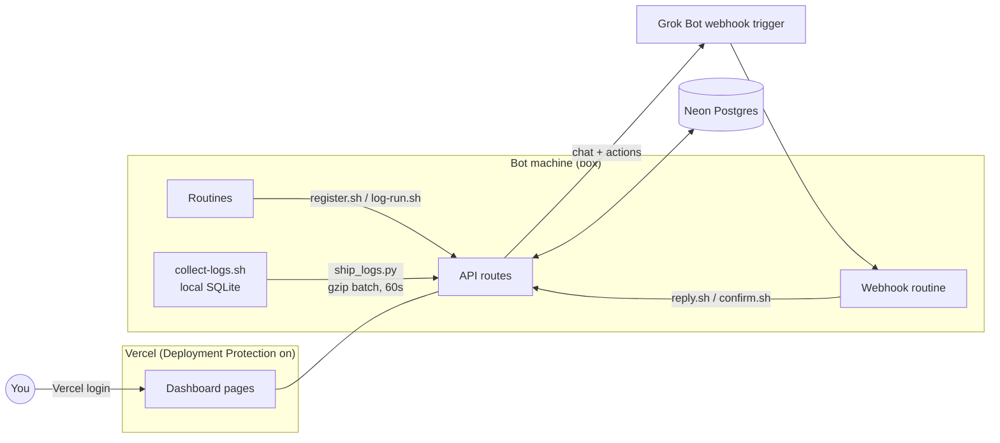

# grokbot-routines

A small dashboard for Grok Bot routines. It lists every routine your bots run, records each run, lets you pause, resume or reschedule a routine, and gives you a chat thread with Grok Bot per routine. It can also show recent logs from the machine your bots run on.

It is a Next.js app on Vercel with a Neon Postgres database. A few shell and Python scripts run on the bot's machine (the "box") and talk to the app over HTTPS.

## How it fits together

A pause works like this. You click Pause, the app stores a pending change and posts it to the Grok Bot webhook. The bot that owns the routine makes the change and calls `confirm.sh`, which clears the pending flag and sets the new status. The page polls every 5 seconds while something is pending and once a minute otherwise, and it stops polling when the tab is hidden.

## Pages

- `/` shows routines grouped by bot, controls, chat and the run history.
- `/logs` shows box logs with filters for source, level, time range and text, 100 lines per page.
- `/settings` holds "Always reply in Grok Bot chat". The value lives in the `config` table so the webhook routine can read it, and it is sent as `also_chat` on every chat and action payload.

## API

| Route | Auth | Purpose |
|---|---|---|
| `POST /api/register` | bearer | add or update a routine |
| `POST /api/runs` | bearer | record a run (`ok`, `error`, `skipped`) |
| `POST /api/messages` | bearer | Grok Bot reply into a thread |
| `POST /api/routines/confirm` | bearer | apply or reject a pending change |
| `POST /api/logs` | bearer | batch log ingest, JSON array, gzip allowed |
| `/api/chat`, `/api/actions`, `/api/settings` | Vercel login | used by the dashboard |

Bearer routes expect `Authorization: Bearer $ROUTINE_LOG_TOKEN` plus the `x-vercel-protection-bypass` header, because Deployment Protection sits in front of everything.

## Setup

1. Create a Vercel project from this repo and add Neon from the Vercel Marketplace. That sets `DATABASE_URL`. Tables are created on first request.
2. Turn on Deployment Protection (Vercel Authentication) and create a Protection Bypass for Automation secret for the box scripts.
3. Set `ROUTINE_LOG_TOKEN` in the project to a long random string.
4. Create a Grok Bot routine with a webhook trigger. Store its URL and key in the `config` table under key `grokbot_webhook` as `{"url": "...", "key": "..."}`. Env vars `GROKBOT_WEBHOOK_URL` and `GROKBOT_WEBHOOK_KEY` work as a fallback.
5. On the box, copy `box/` to a folder of your choice, copy `env.example` to `.env`, fill it in and `chmod 600 .env`. See `box/SETUP.md` for the steps each bot follows to register its routines.

## Box logs

`collect-logs.sh` reads new lines from `/var/log` and `/tmp/*.log` into `logs/box-logs.db` (SQLite) next to the scripts. It keeps a read offset per file, redacts anything that looks like a token, password, key, JWT or credentialed URL, deletes lines older than 30 days and caps the file at 50 MB. Shell histories, `.env` and token files, and agent transcripts are never read.

`ship_logs.py` sends only new lines from allowlisted sources, redacted a second time, in one gzipped POST. When nothing is new it makes no request. Edit `ship-config.json` to change the allow and deny lists. Package manager, browser and VNC logs are denied by default.

`start-log-loop.sh` runs both every 60 seconds at the lowest CPU and IO priority. It is a plain sleep loop with no cron dependency and nothing that would keep the machine awake. Run `logs.sh sources` or `logs.sh -s exec-daemon -l error -t 2h -g timeout` to read the local copy.

The server keeps 7 days and at most 50,000 log rows, pruned on each ingest.

## Security notes

- Every page and route sits behind Vercel Authentication. Bot routes also require the bearer token.
- Secrets live in Vercel env vars, the Neon `config` table and the box `.env`, never in the repo. `.gitignore` excludes `.env*`, `*.token`, `*.jsonl` and key files.
- Scripts never print tokens, and webhook errors mask the key.
- `confirm.sh` and `reply.sh` exit nonzero on any non-2xx response or redirect, so a broken bypass secret shows up as a failure.
- Redaction uses patterns and will miss some secrets. Review `ship-config.json` before allowing a new source.

## Cost

On a Vercel plan you already have, plus Neon's free tier, this costs nothing. Log shipping adds at most one small function call per minute while the box is on, about 43,000 a month. Keep in mind that one write a minute keeps the Neon compute awake while the box runs, so watch compute hours on the free plan. A longer `sleep` in `collect-logs.sh` lets it scale to zero between batches.

## License

MIT
